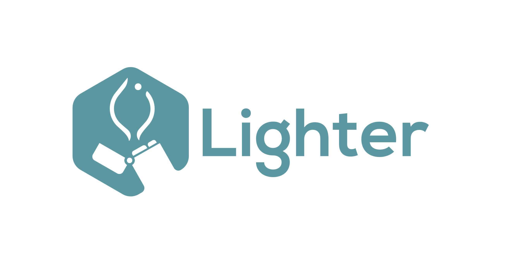

<div align="center">
  
</div>
<br/><br/>
<p align="center">
  <a href="https://github.com/project-lighter/lighter/actions/workflows/ci.yml"></a>
  <a href="https://codecov.io/gh/project-lighter/lighter"></a>
  <a href="https://pypi.org/project/lighter/"></a>
  <a href="https://github.com/project-lighter/lighter/blob/main/LICENSE"></a>
  <a href="https://project-lighter.github.io/lighter"></a>
  <a href="https://discord.gg/zJcnp6KrUp"></a>
</p>
<br/>

**Lighter** makes PyTorch Lightning experiments reproducible and composable through YAML configuration. Stop hardcoding hyperparameters—configure everything from the command line.

## Why Lighter?

You're already using PyTorch Lightning. But every experiment requires editing Python code to change hyperparameters:

```python
# Want to try a different learning rate? Edit the code.
optimizer = Adam(params, lr=0.001)  # Change this line

# Want to use a different batch size? Edit the code.
train_loader = DataLoader(dataset, batch_size=32)  # And this one

# Want to train longer? Edit the code again.
trainer = Trainer(max_epochs=10)  # And this one too
```

**With Lighter, configure everything in YAML and override from the CLI:**

```bash
# Try different learning rates without touching code
lighter fit config.yaml model::learning_rate=0.001
lighter fit config.yaml model::learning_rate=0.01
lighter fit config.yaml model::learning_rate=0.1

# Every experiment is reproducible - just version control your configs
```

## Quick Start

Train a small network on random data, on a CPU, in under a minute:

```bash
pip install lighter
git clone --depth 1 https://github.com/project-lighter/lighter
lighter fit lighter/examples/quickstart/config.yaml
```

[`examples/quickstart`](examples/quickstart) is a plain LightningModule, a dataset and a config.
A `__lighter__.py` file marks the folder, so the config names its code `project.model` and `project.data`.

<!-- examples/quickstart/model.py -->
```python
import pytorch_lightning as pl
import torch


class Regressor(pl.LightningModule):
    def __init__(self, hidden: int = 32, lr: float = 0.01):
        super().__init__()
        self.net = torch.nn.Sequential(torch.nn.Linear(8, hidden), torch.nn.ReLU(), torch.nn.Linear(hidden, 1))
        self.lr = lr

    def training_step(self, batch, batch_idx):
        x, y = batch
        loss = torch.nn.functional.mse_loss(self.net(x), y)
        self.log("train_loss", loss, prog_bar=True)
        return loss

    def configure_optimizers(self):
        return torch.optim.Adam(self.parameters(), lr=self.lr)
```

<!-- examples/quickstart/data.py -->
```python
import torch


class RandomData(torch.utils.data.TensorDataset):
    """Random inputs x and targets y = sum(x), which a small network learns in seconds."""

    def __init__(self, size: int = 1024):
        x = torch.randn(size, 8)
        super().__init__(x, x.sum(dim=1, keepdim=True))
```

<!-- examples/quickstart/config.yaml -->
```yaml
trainer:
  _target_: pytorch_lightning.Trainer
  max_epochs: 10

model:
  _target_: project.model.Regressor
  hidden: 32
  lr: 0.01

data:
  _target_: lighter.LighterDataModule
  train_dataloader:
    _target_: torch.utils.data.DataLoader
    batch_size: 16
    shuffle: true
    dataset:
      _target_: project.data.RandomData
```

Lighter builds each `_target_` with the keys below it as arguments and calls `trainer.fit(model, datamodule=data)`.
Change any value from the command line, without editing a file:

```bash
lighter fit lighter/examples/quickstart/config.yaml model::lr=0.001 trainer::max_epochs=20
```

Each run writes to a new `lightning_logs/version_N/` folder, with the config it ran saved as `config.yaml`.

## Key Benefits

- **Reproducible**: Every experiment = one YAML file. Version control configs like code.
- **Fast iteration**: Override any parameter from CLI without editing code.
- **Zero lock-in**: Works with any PyTorch Lightning module. Your code, your logic.
- **Composable**: Merge configs, create recipes, share experiments as files.
- **Recorded**: Each run saves its composed config next to its logs and inside its checkpoints.
- **Simple**: ~1,200 lines of code. Read the framework in an hour.

## Optional: Use LighterModule for Less Boilerplate

If you want the optimizer, loss and metrics in the config, and the loss and metrics logged per step and per epoch, use `LighterModule`:

```python
from lighter import LighterModule

class MyModel(LighterModule):
    def training_step(self, batch, batch_idx):
        x, y = batch
        pred = self(x)
        loss = self.criterion(pred, y)

        if self.train_metrics is not None:
            self.train_metrics(pred, y)

        return loss  # Lighter logs it as train/loss/step and train/loss/epoch

    # validation_step, test_step, predict_step...
```

```yaml
model:
  _target_: project.model.MyModel
  network:
    _target_: torchvision.models.resnet18
    num_classes: 10
  criterion:
    _target_: torch.nn.CrossEntropyLoss
  optimizer:
    _target_: torch.optim.Adam
    _mode_: callable  # LighterModule calls it with the model's parameters
    lr: 0.001
  train_metrics:
    _target_: torchmetrics.Accuracy
    task: multiclass
    num_classes: 10
```

**LighterModule gives you:**
- Automatic `configure_optimizers()` handling
- Automatic dual logging (step + epoch)
- Config-driven criterion and metrics

**But you still control:**
- All step implementations
- Loss computation logic
- When to call metrics

## Example: Running a Hyperparameter Sweep

```bash
# Run grid search without editing code
for lr in 0.001 0.01 0.1; do
  for bs in 32 64 128; do
    lighter fit config.yaml \
      model::optimizer::lr=$lr \
      data::train_dataloader::batch_size=$bs
  done
done

# Each run logs to its own lightning_logs/version_N/ with its config.yaml
# Compare experiments by diffing those configs
```

## Documentation

- [Quick Start](https://project-lighter.github.io/lighter/quickstart/)
- [Configuration Guide](https://project-lighter.github.io/lighter/guides/configuration/)
- [LighterModule](https://project-lighter.github.io/lighter/guides/lighter-module/)
- [Your Code](https://project-lighter.github.io/lighter/guides/custom-code/)

## Real-World Usage

- 🏥 [Foundation Models for Cancer Imaging](https://aim.hms.harvard.edu/foundation-cancer-image-biomarker)
- 🧠 [Vision Foundation Models for CT](https://arxiv.org/abs/2501.09001)

## Community

- 💬 [Discord](https://discord.gg/zJcnp6KrUp) - Chat with users
- 🐛 [GitHub Issues](https://github.com/project-lighter/lighter/issues) - Report bugs
- 📺 [YouTube](https://www.youtube.com/channel/UCef1oTpv2QEBrD2pZtrdk1Q) - Video tutorials
- 🤝 [Contributing](CONTRIBUTING.md) - Help improve Lighter

## Citation

If Lighter helps your research, please cite our [JOSS paper](https://joss.theoj.org/papers/10.21105/joss.08101):

```bibtex
@article{lighter,
    doi = {10.21105/joss.08101},
    year = {2025}, publisher = {The Open Journal}, volume = {10}, number = {111}, pages = {8101},
    author = {Hadzic, Ibrahim and Pai, Suraj and Bressem, Keno and Foldyna, Borek and Aerts, Hugo JWL},
    title = {Lighter: Configuration-Driven Deep Learning},
    journal = {Journal of Open Source Software}
}
```
